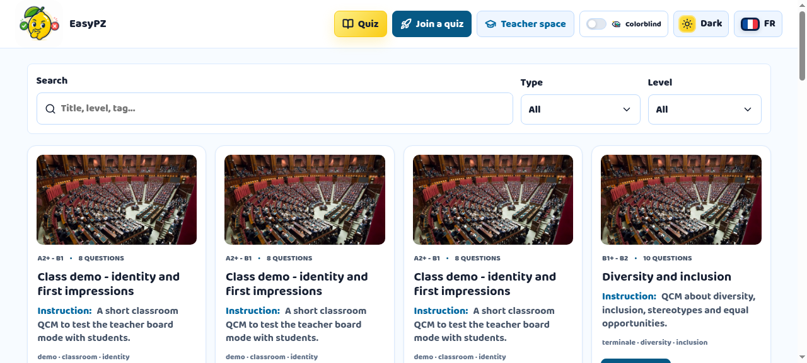
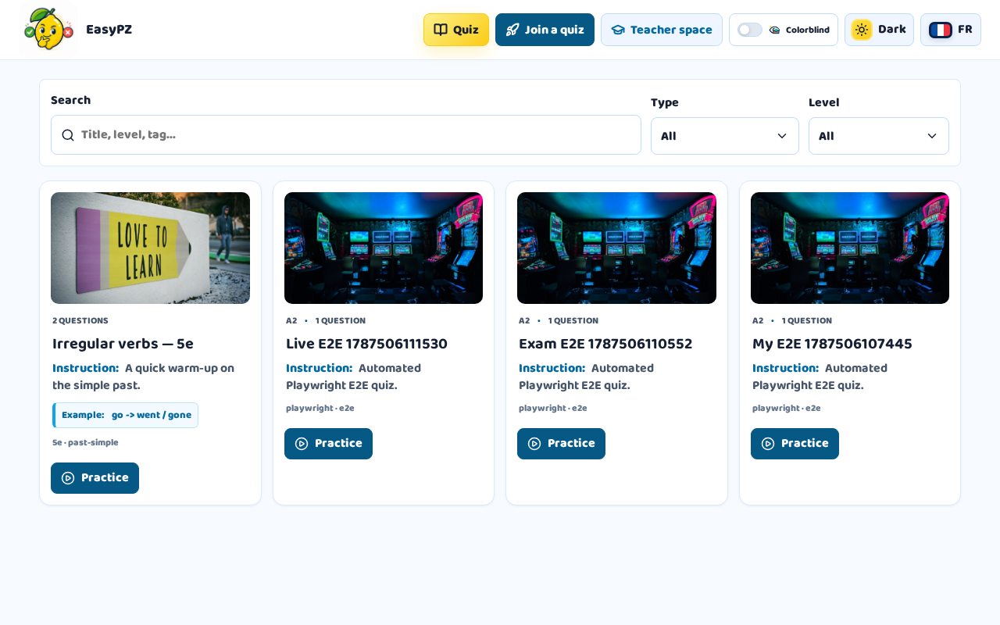
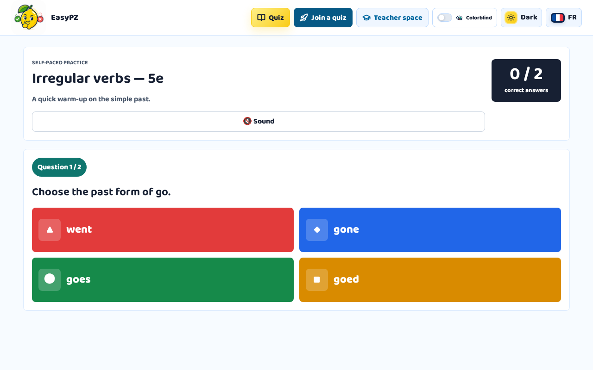
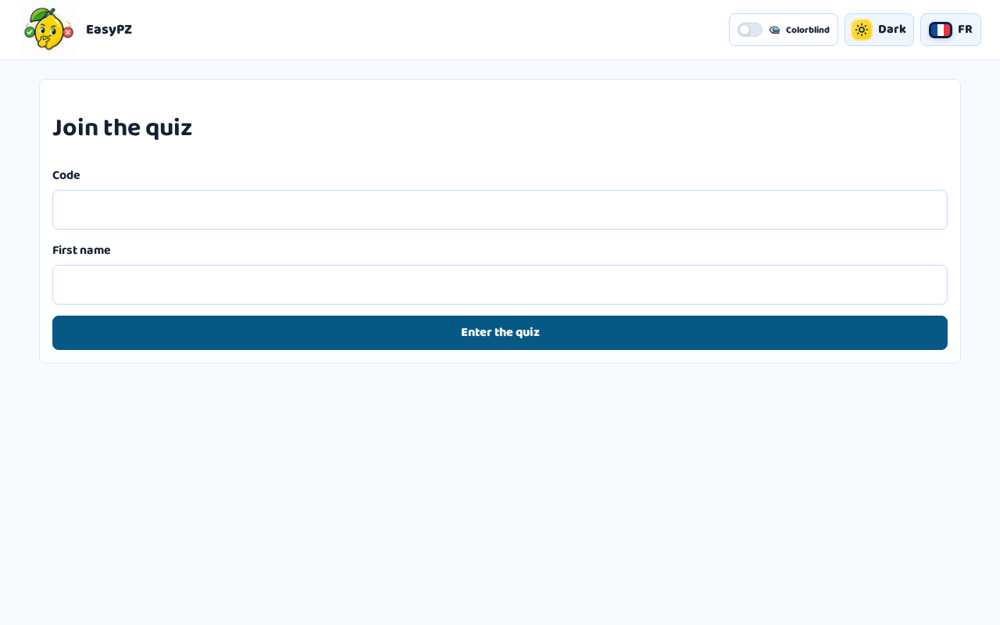
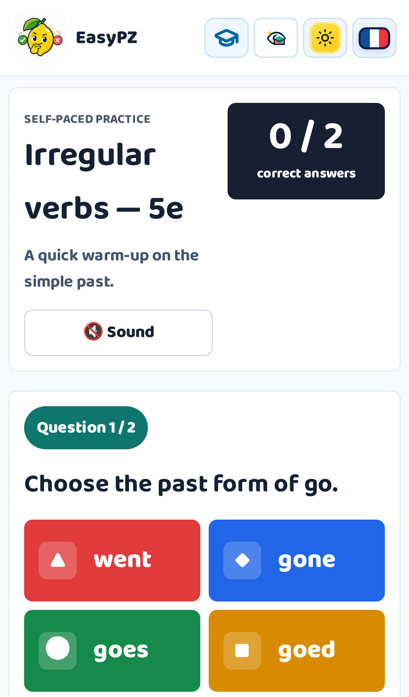
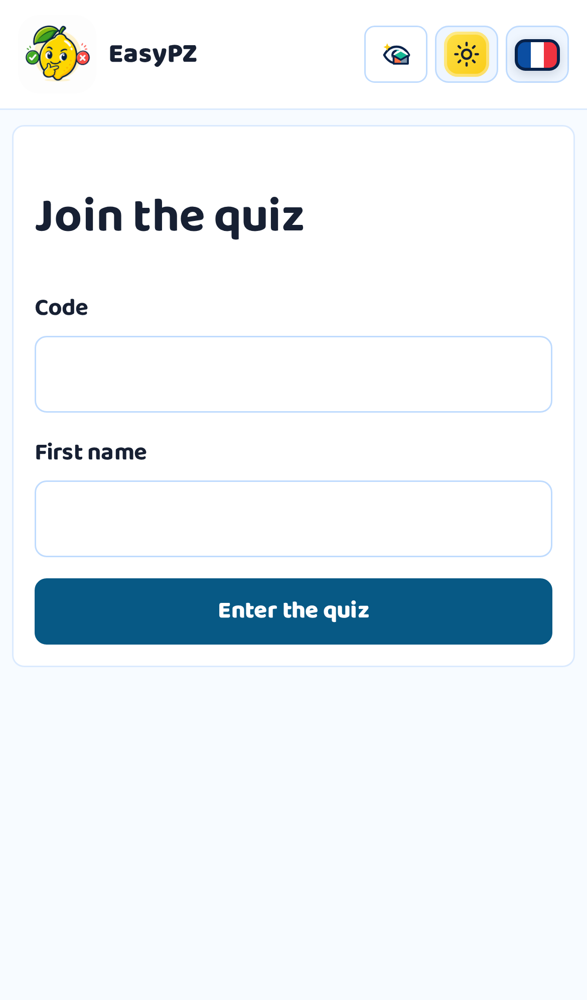

# EasyPZ

Plateforme d'apprentissage de l'anglais : catalogue de quiz, entraînement public, espace
professeur et sessions live en classe.

**En ligne :** https://easypz.fr/ · Fiche portfolio : https://alexisld.fr/


-green)



## Captures d'écran

| Galerie | Parcours apprenant | Rejoindre un quiz |
|---|---|---|
|  |  |  |

Vue mobile (iPhone) :

| Galerie | Parcours apprenant | Rejoindre un quiz |
|---|---|---|
|  |  |  |

## Lecture recruteur

Ce projet montre ma capacité à livrer une expérience produit testable avec plusieurs rôles utilisateur.

- Parcours apprenant clair: recherche, quiz, réponses et feedback immédiat.
- Parcours professeur: création de quiz, banque de questions, salle live et résultats.
- Temps réel: session live avec code court, QR code, participants et leaderboard.
- Déploiement Cloudflare: Worker, D1, R2, workflows de production et smoke tests.

## À vérifier en 30 secondes

1. Ouvrir la démo live et lancer un parcours de quiz.
2. Observer le feedback immédiat après réponse.
3. Vérifier la présence du quiz editor, de la salle live et des vues professeur.

## Stack

- React 19
- TypeScript
- Vite
- Cloudflare Workers / Pages
- Cloudflare D1
- Cloudflare R2
- Vitest
- Playwright / smoke tests WebSocket

## Local Development

```powershell
npm install
npm run db:migrate:local
npm run dev
```

## Verification

```powershell
npm test
npm run build
```

## Browser E2E (Playwright)

A real-browser end-to-end suite runs in CI (job `e2e`) covering the teacher → public gallery → learner flow: the seeded teacher logs in through the UI, creates a published quiz, and a learner plays it in a Chromium browser. It spins up the full local stack (`vite dev` serving the Worker, local D1, static assets) and seeds a throwaway teacher account, so it needs no production data.

```powershell
npm run e2e
```

To debug locally against an already-running `npm run dev`, set `CI=1 npx playwright test` in a separate terminal, or remove `reuseExistingServer` in `playwright.config.ts` to have Playwright manage `db:migrate:local`, `npm run e2e:seed` and `npm run dev` for you.

## Automated 30 Student Live Smoke

Start the local app, then run the smoke with a teacher account:

```powershell
$env:SMOKE_BASE_URL="http://127.0.0.1:5173"
$env:SMOKE_EMAIL="teacher@example.com"
$env:SMOKE_PASSWORD="your-password"
npm run smoke:live30
```

The script creates one quiz, launches a teacher-owned live session, joins 30 students, submits 30 WebSocket answers, ends the session, then checks results and CSV export.

## Classroom Live Smoke Test

1. Log in as a teacher, create a quiz with at least one multiple-choice question, then start a live session from the quiz.
2. Open the teacher room and the board room while authenticated as the owning teacher. The teacher room should show the short join code, QR code, participant count, live controls, and leaderboard.
3. Join from one or more student tabs with `/join/{code}`. Each student should land on `/live/student/{sessionId}/{participantId}`.
4. Click `Demarrer` in the teacher room. The board and student screens should show the active question and real answer choices.
5. Submit answers from student tabs, then verify that answer counts and scores update live.
6. Click `Correction`, `Suivante`, and `Terminer`. The session should end with a leaderboard summary stored in D1.

## Classroom Moderation

Admins can manage teacher access and banned student names from `/admin/allowed-emails`.

- Add teacher emails in `Emails autorises`.
- Add blocked words or emojis in `Mots interdits`.
- Student names are checked when joining a live quiz. Matching is case-insensitive and accent-insensitive, so a banned term like `mechant` also blocks `Méchant`.

## Quiz Duplication

Teachers can duplicate a quiz from the dashboard. The copy includes questions, choices, accepted short-answer corrections, and media references, but it is always created as a private draft with a new slug. Live sessions, history, and results are never copied.

## Secret Links

Teachers can publish a quiz with a secret practice link from the dashboard. Secret-link quizzes are playable at `/practice/secret/{token}` but do not appear in the public gallery.

## Question Images

Teachers can attach one image to each quiz question from the editor. Images are uploaded to the Cloudflare R2 media bucket, saved as question media references, and displayed in public practice plus live board/student views. Supported formats are PNG, JPEG, WebP, and GIF up to 3 MB.

Media reads (`/api/media/images|audio/{key}`) are public and unauthenticated because question images must render for anonymous public practice and for live students who are not logged in. Access control relies on each key being a non-guessable UUID (`teachers/{teacherId}/{uuid}.ext`) rather than a signed URL. This is an accepted trade-off: it keeps anonymous/student displays simple, at the cost of not being able to revoke a single leaked key. Media responses are served with `public, max-age=31536000, immutable` caching and `X-Content-Type-Options: nosniff`.

## Question Bank

Teachers can manage a personal question bank from `/question-bank`.

- Create, edit, delete, search, and filter reusable questions.
- Insert bank questions into a quiz from the editor with `Depuis ma banque`.
- New quiz questions default to `Ajouter a ma banque`.
- Existing exact duplicates are skipped.
- Similar questions show an in-app confirmation before adding.

## Word Order Questions

Teachers can create `Ordre des mots` questions by entering the correct sentence. Students rebuild the sentence by tapping shuffled word tokens in public practice and live sessions. Answers are normalized for case, accents, punctuation, and spacing before scoring.

## Class Results Analysis

Live session results include class-level analysis: global success rate, participation rate, per-question success, questions to review, unanswered counts, and frequent wrong answers. This helps teachers decide what to revisit after a session.

## Cloudflare Setup

```powershell
npx wrangler login
npx wrangler d1 create quiz_english
npx wrangler r2 bucket create quiz-english-media
npm run db:migrate:remote
npm run deploy
```

After `wrangler d1 create quiz_english`, copy the printed database id into `wrangler.jsonc` as `database_id`.

Initial admin email: `prof@example.org`.

Primary target domain: `https://easypz.fr/`.

Additional configured domains: `https://www.easypz.fr/`, `https://easypz.study/`, `https://www.easypz.study/`, and `https://easypz.fr/`.

## Production Deploy

Production deploys can be run from the manual `Deploy Production` GitHub Actions workflow. GitHub only lists and dispatches manual workflows after the workflow file exists on the repository default branch.

Required GitHub secrets:

- `CLOUDFLARE_API_TOKEN`
- `CLOUDFLARE_ACCOUNT_ID`

Optional smoke-test secrets:

- `SMOKE_COOKIE`
- or `SMOKE_EMAIL` and `SMOKE_PASSWORD`

If no smoke-test secret is configured and `run_smoke=true`, the workflow creates a temporary allowlisted teacher account for the run and removes it during cleanup.

The workflow runs typecheck, tests, build, exports a remote D1 backup artifact, applies remote D1 migrations, deploys with Wrangler, then optionally runs the 30-student live smoke test against `https://easypz.fr`.

The production workflow keeps existing Cloudflare route/custom-domain bindings instead of rewriting routes on every deploy. If a new domain or route is added to `wrangler.jsonc`, update Cloudflare routes manually or grant the deploy token `Zone > Workers Routes > Edit` for the affected zones before relying on the workflow to manage routes.

The `Production Health` GitHub Actions workflow is a manual post-deploy monitor (run via `workflow_dispatch`). It checks `https://easypz.fr/`, validates `/api/public/quizzes`, captures a short `wrangler tail --status=error` window for the `quiz-english` Worker, uploads the tail log as an artifact, and fails if obvious Worker error signals are found. It can be triggered on demand after any deploy.

If you prefer to run the monitor from a local cron instead of clicking the GitHub UI, `scripts/production-health-dispatch.sh` triggers the same workflow every time it runs.

For a local authenticated deploy, keep the same order:

```powershell
mkdir backups
npx wrangler d1 export quiz_english --remote --skip-confirmation --output backups/quiz_english-YYYYMMDD-HHMMSS.sql
npm run db:migrate:remote
npm run deploy
```

## Licence

ISC — voir [LICENSE](LICENSE).

## À propos de ce dépôt

Code publié à titre de démonstration technique (React 19 + TypeScript strict côté client,
Cloudflare Workers / D1 / R2 côté serveur, E2E Playwright). L'historique de développement
interne et les notes de conception ont été retirés de cette version publique ; aucune clé
ni donnée personnelle n'y figure. Un `.dev.vars.example` liste les variables attendues.
