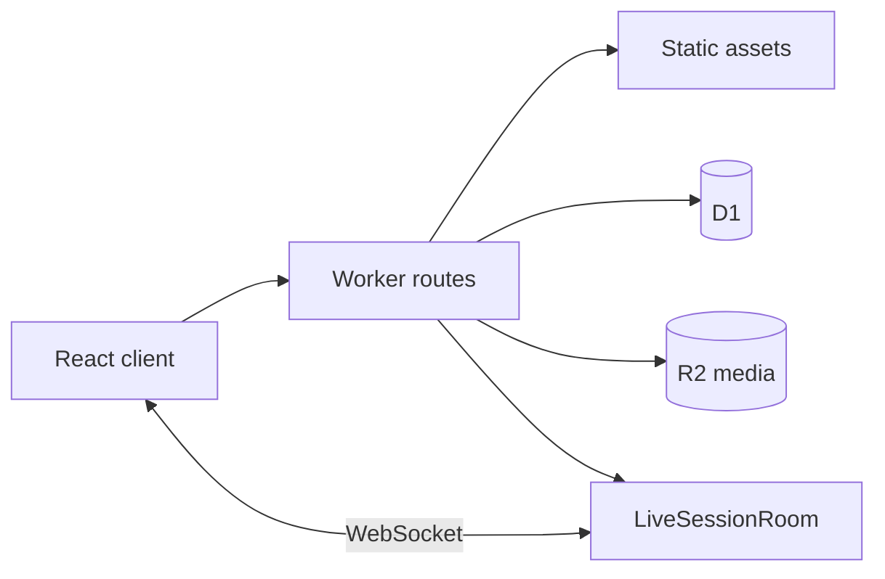

# Architecture

## Request flow

Vite serves the React client and integrates the local Worker through the Cloudflare plugin.
In deployment, the Worker serves API routes and delegates static requests to the `ASSETS` binding.
`worker/index.ts` dispatches requests to domain route modules. Route modules validate input,
authorize users and call D1, R2 or the live-session Durable Object.

## Client boundaries

`src/api/` contains the HTTP client. `src/features/` groups UI components and pure view-model
helpers by feature. Navigation, authentication routing and translations live alongside those features.
Pure helpers support fast unit tests without mounting the interface; component tests use jsdom.

The public-gallery model normalizes title, tags and level before matching ordered, whole-word theme
patterns. Specific patterns reduce accidental thematic collisions. A caller-owned set reserves covers
for the current gallery pass: collisions take the first unused illustration. Once all 16 are used,
thematic covers repeat. Input order therefore matters, and uniqueness is not unlimited.

## Server boundaries

- `auth/`, `admin/`, `security/` and `http/` handle sessions, roles, moderation administration,
  rate limits, origin checks and response handling.
- `quizzes/`, `questionBank/`, `public/` and `practice/` handle authoring, publication and attempts.
- `live/` owns the room protocol, state transitions, timing, answer evaluation, scoring and results.
- `analytics/` aggregates teacher results; `media/` handles upload and public reads.
- `codeInbox/` handles the email-code inbox integration.

D1 stores accounts, quiz data and persisted results. R2 stores media objects.
`LiveSessionRoom` coordinates live participants over WebSockets. The serial task queue preserves
mutation order even when an earlier asynchronous task rejects. Answer evaluation checks timing and
duplicates before application updates scores; callers must preserve that sequencing.

## Data and security

SQL migrations are ordered in `migrations/`; review changes against both an empty database and the
previous schema. Never run fixture seeding against production. The initial allowlist uses an example
address and must be configured privately for an actual deployment.

Media reads are public so anonymous learners can render questions. An opaque key is not a private
access policy. See [SECURITY.md](../SECURITY.md) for boundaries and reporting.

## Validation layers

Vitest covers pure models, routes with test doubles and selected React rendering. Playwright exercises
the local integrated stack on desktop and mobile viewports. The default public CI runs the former,
type checking, lint, build and the static cover validator; browser and live-load checks are separate.
